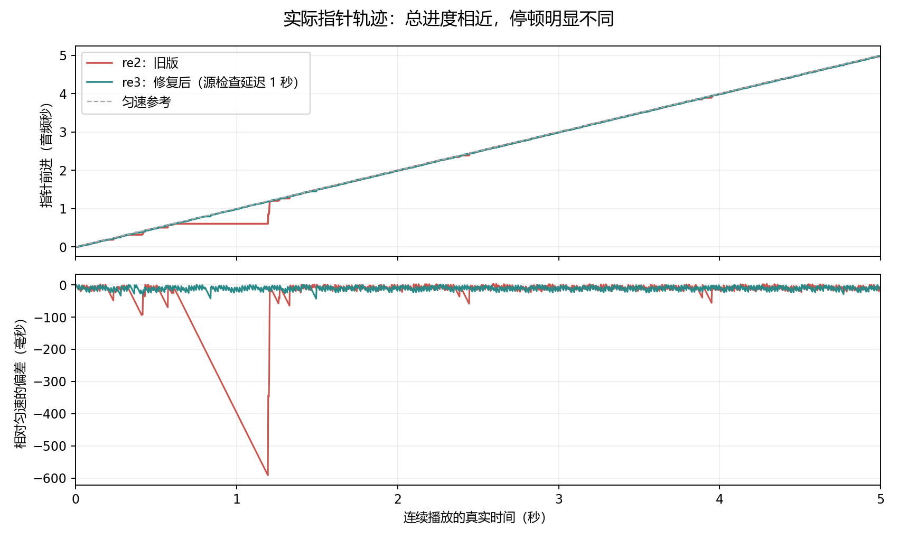

# 0.7.8 re3：播放流畅度验证（2026-10-29）

## 复现与测量

用户录像为 1920×1032 / 30 fps。排除静止的白色虚线后，跟踪播放实线；正常片段速度约 114.7、115.8、115.8 px/s，与当前视口的预期 116.84 px/s 接近，但检测到约 300、667、500、900 ms 的停住段，底部时间读数也同时停住。正常段或整段的平均速度不能排除卡顿。

真实 Windows 桌面旧版复测捕获约 587.1 ms 的实际位移停顿和 580 ms 主线程长任务；该段音频缓冲欠载为 0。旧版随后在定位控制阶段超时，因此只把已完成的首段稳态测量作为旧版基准，不宣称旧版整套组合测试通过。

新诊断分别记录实际位置变化、RAF、主线程长任务、原生事件、消费帧和缓冲欠载。相同位置的重复样式写入不算移动。没有增加 250 ms 的原生确认预测上限，没有降低 FFT、频谱像素尺寸或绘制精度。图中两次更新之间保留上次实际位置，不以插值掩盖停顿。

## 实现

- 音频生产线程仅补充本机 PCM/DSP。源文件校验与进度发布使用两个有界常驻工作线程，各保留一个当前任务和一个可替换的待执行任务；较慢的查询不会堆积线程。保留首次校验和周期检查，错误、暂停、关闭、换源及迟到的旧结果受播放代次与取消状态约束。
- 共享 DTO 仍进行完整结构、字节预算和引用校验。UTF-8 JSON 字符串计数不再逐字符串分配编码；完整校验放入单个 Worker。所有字段变化都比较真实内容，未变化的字段复用已验证且冻结的对象；Worker 基准、异常、超时和替换均有围栏。不依赖声明的修订或哈希来跳过变更。
- 本机目录、回收站与维护状态保留相同快照，不为空轮询通知整个工作区；同步时间使用单独的窄订阅。真实共享变化、恢复和错误仍通知。
- 播放实线缓存宽度，使用 translate3d 与独立 RAF；列表按行缓存，动作读取最新所有者。菜单选项、隐藏集合和刻度仅在相关数据改变时重新计算。
- 所有频谱共用 6 ms 帧预算，短条绘制可以取消。共享 RGBA 临时缓冲仍受资源预算限制；交错绘制与部分末条逐字节对比同步参考结果相同。

## 最终桌面结果

固定外窗 1920×1050；每个稳态播放段持续 5 秒。源检查延迟 1000 ms 只存在于 E2E 构建，属于受控延迟，不能当作实际 NAS 性能测量。

| 工作负载 | 原音 1 通道 | 处理后 1 通道 | 原音 6 通道 | 处理后 6 通道 |
| --- | ---: | ---: | ---: | ---: |
| 项目元数据副本：实际指针位移间隔最大值 | 45.5 ms | 27.8 ms | 32.8 ms | 29.9 ms |
| 完整合成音频及非空编辑：实际指针位移间隔最大值 | 30.9 ms | 21.4 ms | 20.8 ms | 25.5 ms |
| 两组缓冲欠载 | 0 | 0 | 0 | 0 |

两组八段稳态均无 ≥50 ms 主线程长任务、无 ≥100 ms 位移停住段、无指针倒退；RAF 的 95 分位约 16.7 ms。播放中两次改变显示增益的最大位移间隔分别为 80.0 / 45.6 ms，原生音频代次不变、缓冲欠载为 0。主动制造的 220 ms 主线程阻塞仍会检出约 222–226 ms 的实线停顿，单独记录，不纳入稳态结果。

元数据副本包含 1797 条目录记录（含回收站）。只有所播的真实音频副本及六通道合成音频有效，其余 1792 个源是匹配字节长度的占位文件，仅用于复现目录/UI 负载；未播放占位文件，不能据此声称导入了 1797 条真实音频。原用户项目只读，所有测试写入独占副本。

另一项目包含 877 个完整有效合成音频；单声道与六通道分别带 2 / 12 个实际屏蔽和增益编辑。保存后的编辑、配置和源指纹一致；两种音频的数值探针均测得屏蔽衰减约 141.5834 dB、增益 −6 dB，原音和处理后数值确实不同。

真实组合操作包含播放中 +20 dB 监听增益、暂停/继续、定位、循环、自然结束、关闭/重新打开所有者、播放中重绘。两组计时测试分别通过 39 / 41 项检查。查看处理通过 3 组，查看可用性通过 15 组，包括右键定位、目标框、缩放、最大化/还原、设置点外关闭、实际源暂时不可用后的停止与恢复。

## 回归与证据

- 前端完整运行：118 文件、1169 项全部通过（`npx vitest run --maxWorkers=2`）。首次完整运行发现两处回收站缓存失效边界和旧绘制 mock；修正后重跑通过。十二通道/五次完整绘制的测试现在跨帧运行，整例允许 60 秒，每阶段仍等待真实绘制完成，性能阈值由独立桌面测试验证。
- Rust 工作区：587 通过、9 个既有/外部环境 opt-in 忽略；包含阻塞检查不影响独立进度、旧代次不能停止新源、取消监视与错误发布顺序。随后仅格式化导入顺序，语义未改。
- 类型检查、正式前端构建、22 项桌面工具/套件注册检查、诊断脚本语法和 diff 检查通过。
- 像素、资源、取消、Unicode 全码元、缓存不信任输入、Worker 基准和故障恢复均有回归测试。初始候选未达到性能门槛，失败记录保留，没有通过放宽指针门槛让其通过。

原始证据位于独占本机输出目录，不提交包含用户项目元数据的报告：

- `.test-output/playhead-video`：录像轨迹、构建、完整测试、失败候选及最终日志。
- `D:/Work/annotator/.test-output/playhead-runtime/final-recorded-delay-Pq7uR6/report.json`：元数据副本、源检查延迟。
- `D:/Work/annotator/.test-output/playhead-runtime/final-processed-delay-XQfrQm/report.json`：877 条有效音频及非空处理。
- `review-processing/desktop-Lvg1Hu/report.json`、`review-usability/desktop-xePkqG/report.json`：同一输出根下的查看组合检查。

没有声学回环采集；消费帧、原生时间和零欠载不能证明每种声卡/驱动/NAS 条件都绝无物理输出停顿。没有声称执行全部历史桌面发布套件，也没有覆盖安装或改动用户项目。此次不改变音频切换黑屏、类别治理、评价/复标或导入去重。
